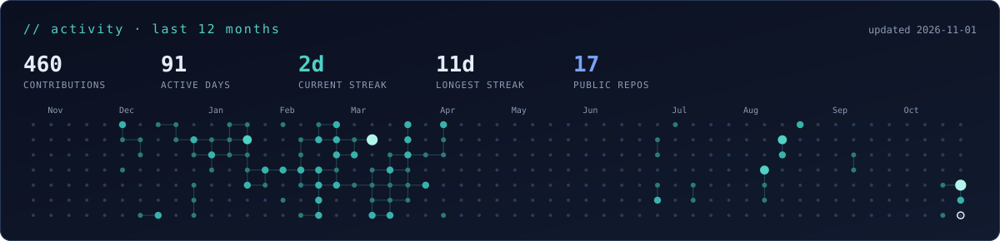
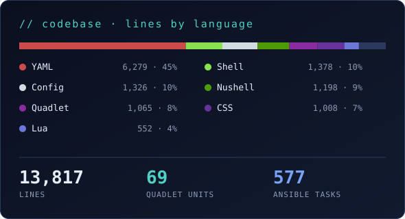
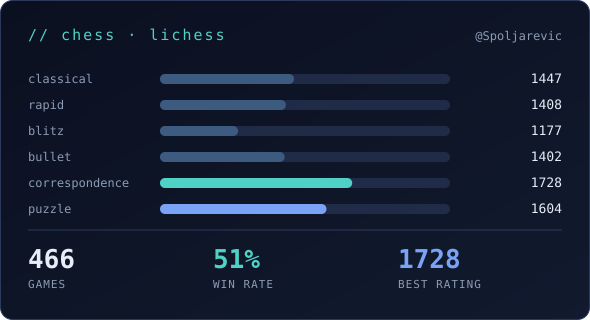

  

### transmission

Linux sysadmin and DevOps engineer, half German 🇩🇪, half Croatian 🇭🇷 — I automate infrastructure with Ansible and run it as rootless Podman containers.
Privacy-centric, FOSS by default, founder of Who2Industries; if I can self-host it, I will.

### nodes (currently active)

- `n01` · [Spoljarevic/Arch_Linux_Post-Install_Automation](https://codeberg.org/Spoljarevic/Arch_Linux_Post-Install_Automation) — reworked post-install playbook, currently in the testing branch
- `n02` · [Spoljarevic/Grafana-Server-Monitoring](https://codeberg.org/Spoljarevic/Grafana-Server-Monitoring) — rootless Grafana monitoring stack as Podman Quadlets
- `n03` · [Spoljarevic/ansible-galaxy-rhel-based-hardening](https://codeberg.org/Spoljarevic/ansible-galaxy-rhel-based-hardening) — Ansible role hardening RHEL and Rocky Linux

### telemetry

  

  
  

rendered daily from the Codeberg and Lichess APIs by <a href="./scripts/stats.py"><code>scripts/stats.py</code></a>

### archive (shipped)

- `a01` · [Spoljarevic/Zammad-Podman-Quadlets](https://codeberg.org/Spoljarevic/Zammad-Podman-Quadlets) — Quadlets for the Zammad ticket system · [docs](https://kb.spoljarevic.sh/Big-Projects/Zammad-Podman-Quadlets/)
- `a02` · [Spoljarevic/ansible-galaxy-archlinux-repomanager](https://codeberg.org/Spoljarevic/ansible-galaxy-archlinux-repomanager) — Galaxy role adding the CachyOS and BlackArch repos to vanilla Arch · [docs](https://galaxy.ansible.com/ui/standalone/roles/spoljarevic/archlinux-repomanager/documentation/)
- `a03` · [Spoljarevic/FreePBX-17-Container](https://codeberg.org/Spoljarevic/FreePBX-17-Container) — containerized FreePBX 17 setup · [docs](https://kb.spoljarevic.sh/Big-Projects/FreePBX-17-Docker-Setup/)
- `a04` · [Spoljarevic/Dotfiles](https://codeberg.org/Spoljarevic/Dotfiles/src/branch/master/nvim) — my Neovim config and the rest of my desktop · [docs](https://kb.spoljarevic.sh/Other-Repos/Dotfiles/Neovim/)

### stack

`linux` · `bash` · `ansible` · `podman` · `git`

### endpoints

[`spoljarevic.sh`](https://spoljarevic.sh) · [`@spoljarevic`](https://codeberg.org/spoljarevic) · [`foss@spoljarevic.sh`](mailto:foss@spoljarevic.sh)

[`lichess`](https://lichess.org/@/Spoljarevic) · [`dwz`](https://www.schachbund.de/dwz-spieler.html?search=spoljarevic) · [`fide`](https://ratings.fide.com/profile/533099588) · [`kb.spoljarevic.sh`](https://kb.spoljarevic.sh)

source lives on <a href="https://codeberg.org/spoljarevic">Codeberg</a>; other forges only carry mirrors · <a href="./LICENSE">MIT-0</a>
