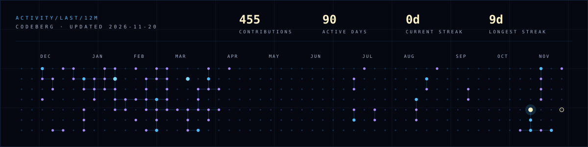

<!-- generated by scripts/stats.py from scripts/profile.toml; edit that file, not this one -->

# Luca Matteo Špoljarević

**Linux sysadmin and DevOps engineer, half German, half Croatian.**
I automate infrastructure with Ansible and run it as rootless Podman containers. Privacy-centric, FOSS by default, founder of Who2Industries; if I can self-host it, I will.

`linux` · `bash` · `ansible` · `podman` · `git`

## Currently active

<strong>Arch_Linux_Post-Install_Automation</strong> · <code>python · upd 2026-11-09</code>

reworked post-install playbook, currently in the testing branch

**Repo:** [Spoljarevic/Arch_Linux_Post-Install_Automation](https://codeberg.org/Spoljarevic/Arch_Linux_Post-Install_Automation) · **Docs:** [kb.spoljarevic.sh/Big-Projects/Arch-Linux-Post-Install-Automation](https://kb.spoljarevic.sh/Big-Projects/Arch-Linux-Post-Install-Automation/)

<strong>Grafana-Server-Monitoring</strong> · <code>shell · upd 2026-11-02</code>

rootless Grafana monitoring stack as Podman Quadlets

**Repo:** [Spoljarevic/Grafana-Server-Monitoring](https://codeberg.org/Spoljarevic/Grafana-Server-Monitoring)

<strong>ansible-galaxy-rhel-based-hardening</strong> · <code>shell · upd 2026-11-02</code>

Ansible role hardening RHEL and Rocky Linux

**Repo:** [Spoljarevic/ansible-galaxy-rhel-based-hardening](https://codeberg.org/Spoljarevic/ansible-galaxy-rhel-based-hardening)

<strong>archived</strong> · <em>4 shipped builds</em>

- [Zammad-Podman-Quadlets](https://codeberg.org/Spoljarevic/Zammad-Podman-Quadlets) — Quadlets for the Zammad ticket system · [docs](https://kb.spoljarevic.sh/Big-Projects/Zammad-Podman-Quadlets/)
- [ansible-galaxy-archlinux-repomanager](https://codeberg.org/Spoljarevic/ansible-galaxy-archlinux-repomanager) — Galaxy role adding the CachyOS and BlackArch repos to vanilla Arch · [docs](https://galaxy.ansible.com/ui/standalone/roles/spoljarevic/archlinux-repomanager/documentation/)
- [FreePBX-17-Container](https://codeberg.org/Spoljarevic/FreePBX-17-Container) — containerized FreePBX 17 setup · [docs](https://kb.spoljarevic.sh/Big-Projects/FreePBX-17-Docker-Setup/)
- [Dotfiles](https://codeberg.org/Spoljarevic/Dotfiles/src/branch/master/nvim) — my Neovim config and the rest of my desktop · [docs](https://kb.spoljarevic.sh/Other-Repos/Dotfiles/Neovim/)

## Telemetry

14 public repos · last push 2026-11-15 · rendered 2026-11-15 from the Codeberg and Lichess APIs

<strong>codebase</strong> · <code>13,452 lines · 69 quadlet units · 486 ansible tasks</code>

Non-empty lines across my public repos.

| language | lines | share |
|---|---:|---:|
| yaml | 5,696 | 42% |
| shell | 1,518 | 11% |
| config | 1,331 | 10% |
| nushell | 1,198 | 9% |
| quadlet | 1,065 | 8% |
| python | 837 | 6% |
| other | 1,807 | 13% |

<strong>chess</strong> · <code>best 1728 · correspondence</code>

| variant | rating | games |
|---|---:|---:|
| classical | 1447 | 16 |
| rapid | 1408 | 65 |
| blitz | 1204 | 103 |
| bullet | 1402 | 18 |
| correspondence | 1728 | 22 |
| puzzle | 1604 | 185 |

468 games · 51% win rate · [@Spoljarevic on lichess](https://lichess.org/@/Spoljarevic)

## Endpoints

**contact** — web: [spoljarevic.sh](https://spoljarevic.sh) · forge: [@spoljarevic](https://codeberg.org/spoljarevic) · fedi: [@spoljarevic@techhub.social](https://techhub.social/@spoljarevic) · mail: [foss@spoljarevic.sh](mailto:foss@spoljarevic.sh)

**elsewhere** — chess: [lichess](https://lichess.org/@/Spoljarevic) · chess: [dwz](https://www.schachbund.de/dwz-spieler.html?search=spoljarevic) · chess: [fide](https://ratings.fide.com/profile/533099588) · docs: [kb.spoljarevic.sh](https://kb.spoljarevic.sh)

---

<a href="https://codeberg.org/spoljarevic">source on codeberg · other forges carry mirrors · mit-0</a>
