<!-- generated by scripts/stats.py from scripts/profile.toml; edit that file, not this one -->

  

  
  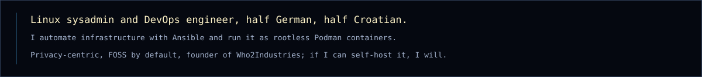

  
  <a href="https://codeberg.org/Spoljarevic/Arch_Linux_Post-Install_Automation"></a><a href="https://kb.spoljarevic.sh/Big-Projects/Arch-Linux-Post-Install-Automation/">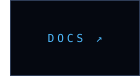</a>
  <a href="https://codeberg.org/Spoljarevic/Grafana-Server-Monitoring"></a><a href="https://codeberg.org/Spoljarevic/Grafana-Server-Monitoring">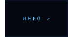</a>
  <a href="https://codeberg.org/Spoljarevic/ansible-galaxy-rhel-based-hardening"></a>

  
  

  
  

  
  <a href="https://codeberg.org/Spoljarevic/Zammad-Podman-Quadlets"></a><a href="https://kb.spoljarevic.sh/Big-Projects/Zammad-Podman-Quadlets/">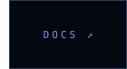</a>
  <a href="https://codeberg.org/Spoljarevic/ansible-galaxy-archlinux-repomanager"></a>
  <a href="https://codeberg.org/Spoljarevic/FreePBX-17-Container"></a>
  <a href="https://codeberg.org/Spoljarevic/Dotfiles/src/branch/master/nvim"></a>

  
  

  

  <a href="https://spoljarevic.sh">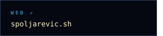</a><a href="https://codeberg.org/spoljarevic">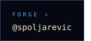</a><a href="https://techhub.social/@spoljarevic">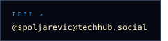</a><a href="mailto:foss@spoljarevic.sh">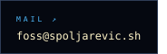</a>

  <a href="https://lichess.org/@/Spoljarevic">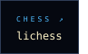</a><a href="https://www.schachbund.de/dwz-spieler.html?search=spoljarevic">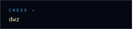</a><a href="https://ratings.fide.com/profile/533099588">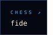</a><a href="https://kb.spoljarevic.sh">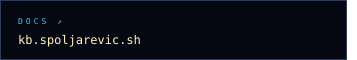</a>

  

