<!-- generated by scripts/stats.py from scripts/profile.toml; edit that file, not this one -->

📱 <strong>On a phone? Tap here for the text-based view</strong>

# Luca Matteo Špoljarević

**Linux sysadmin and DevOps engineer, half German, half Croatian.**\
I automate infrastructure with Ansible and run it as rootless Podman containers. Privacy-centric, FOSS by default, founder of Who2Industries; if I can self-host it, I will.

`linux` · `bash` · `ansible` · `podman` · `git`

## Projects

3 ACTIVE · 4 ARCHIVED · ONE CLICK TO EXPAND

<strong>Arch_Linux_Post-Install_Automation</strong> · <code>ansible</code> <code>archlinux</code> <code>semaphore</code> · 🟢 active

Reworked post-install playbook, currently in the **testing branch**.

| commits · last 12 weeks | `········█▁··` |
|---|---:|
| commits total | 53 |
| last commit | 2026-11-08 |
| language | python |

**Repo:** [Spoljarevic/Arch_Linux_Post-Install_Automation](https://codeberg.org/Spoljarevic/Arch_Linux_Post-Install_Automation) · **Docs:** [kb.spoljarevic.sh/Big-Projects/Arch-Linux-Post-Install-Automation](https://kb.spoljarevic.sh/Big-Projects/Arch-Linux-Post-Install-Automation/)

<strong>Grafana-Server-Monitoring</strong> · <code>grafana</code> <code>podman</code> <code>quadlet</code> · 🟢 active

Rootless Grafana monitoring stack as **Podman Quadlets**.

| commits · last 12 weeks | `·▆█·····▆···` |
|---|---:|
| commits total | 7 |
| last commit | 2026-11-02 |
| language | shell |

**Repo:** [Spoljarevic/Grafana-Server-Monitoring](https://codeberg.org/Spoljarevic/Grafana-Server-Monitoring)

<strong>ansible-galaxy-rhel-based-hardening</strong> · <code>ansible</code> <code>rhel</code> <code>hardening</code> · 🟢 active

Ansible role hardening **RHEL and Rocky Linux**.

| commits · last 12 weeks | `········█···` |
|---|---:|
| commits total | 5 |
| last commit | 2026-11-02 |
| language | shell |

**Repo:** [Spoljarevic/ansible-galaxy-rhel-based-hardening](https://codeberg.org/Spoljarevic/ansible-galaxy-rhel-based-hardening)

<strong>Zammad-Podman-Quadlets</strong> · <code>zammad</code> <code>podman</code> <code>quadlet</code> · <em>archived</em>

Quadlets for the **Zammad** ticket system.

| commits · last 12 weeks | `········█▆··` |
|---|---:|
| commits total | 11 |
| last commit | 2026-11-08 |
| language | shell |

**Repo:** [Spoljarevic/Zammad-Podman-Quadlets](https://codeberg.org/Spoljarevic/Zammad-Podman-Quadlets) · **Docs:** [kb.spoljarevic.sh/Big-Projects/Zammad-Podman-Quadlets](https://kb.spoljarevic.sh/Big-Projects/Zammad-Podman-Quadlets/)

<strong>ansible-galaxy-archlinux-repomanager</strong> · <code>ansible</code> <code>galaxy</code> <code>archlinux</code> · <em>archived</em>

Galaxy role adding the **CachyOS and BlackArch** repos to vanilla Arch.

| commits · last 12 weeks | `········█···` |
|---|---:|
| commits total | 6 |
| last commit | 2026-11-03 |

**Repo:** [Spoljarevic/ansible-galaxy-archlinux-repomanager](https://codeberg.org/Spoljarevic/ansible-galaxy-archlinux-repomanager) · **Docs:** [galaxy.ansible.com/ui/standalone/roles/spoljarevic/archlinux-repomanager/documentation](https://galaxy.ansible.com/ui/standalone/roles/spoljarevic/archlinux-repomanager/documentation/)

<strong>FreePBX-17-Container</strong> · <code>freepbx</code> <code>podman</code> <code>voip</code> · <em>archived</em>

Containerized **FreePBX 17** setup.

| commits · last 12 weeks | `········█···` |
|---|---:|
| commits total | 11 |
| last commit | 2026-11-01 |

**Repo:** [Spoljarevic/FreePBX-17-Container](https://codeberg.org/Spoljarevic/FreePBX-17-Container) · **Docs:** [kb.spoljarevic.sh/Big-Projects/FreePBX-17-Docker-Setup](https://kb.spoljarevic.sh/Big-Projects/FreePBX-17-Docker-Setup/)

<strong>Dotfiles</strong> · <code>neovim</code> <code>hyprland</code> <code>nushell</code> · <em>archived</em>

My **Neovim** config and the rest of my desktop.

| commits · last 12 weeks | `········█·▃·` |
|---|---:|
| commits total | 112 |
| last commit | 2026-11-15 |
| language | nushell |

**Repo:** [Spoljarevic/Dotfiles](https://codeberg.org/Spoljarevic/Dotfiles/src/branch/master/nvim) · **Docs:** [kb.spoljarevic.sh/Other-Repos/Dotfiles/Neovim](https://kb.spoljarevic.sh/Other-Repos/Dotfiles/Neovim/)

## Telemetry

14 public repos · last push 2026-11-16 · rendered 2026-11-25 from the Codeberg and Lichess APIs

<strong>codebase</strong> · <code>13,601 lines · 73 quadlet units · 486 ansible tasks</code>

Non-empty lines across my public repos.

| language | lines | share |
|---|---:|---:|
| yaml | 5,696 | 42% |
| shell | 1,518 | 11% |
| config | 1,331 | 10% |
| nushell | 1,198 | 9% |
| quadlet | 1,093 | 8% |
| python | 950 | 7% |
| other | 1,815 | 13% |

<strong>chess</strong> · <code>best 1728 · correspondence</code>

| variant | rating | games |
|---|---:|---:|
| classical | 1447 | 16 |
| rapid | 1408 | 65 |
| blitz | 1205 | 115 |
| bullet | 1402 | 18 |
| correspondence | 1728 | 22 |
| puzzle | 1604 | 185 |

481 games · 51% win rate · [@Spoljarevic on lichess](https://lichess.org/@/Spoljarevic)

## Endpoints

**contact** — web: [spoljarevic.sh](https://spoljarevic.sh) · forge: [@spoljarevic](https://codeberg.org/spoljarevic) · fedi: [@spoljarevic@techhub.social](https://techhub.social/@spoljarevic) · mail: [foss@spoljarevic.sh](mailto:foss@spoljarevic.sh)

**elsewhere** — chess: [lichess](https://lichess.org/@/Spoljarevic) · chess: [dwz](https://www.schachbund.de/dwz-spieler.html?search=spoljarevic) · chess: [fide](https://ratings.fide.com/profile/533099588) · docs: [kb.spoljarevic.sh](https://kb.spoljarevic.sh)

---

<a href="https://codeberg.org/spoljarevic">source on codeberg · other forges carry mirrors · mit-0</a>

<!--
--><!--
--><!--
--><!--
--><!--
--><a href="https://codeberg.org/Spoljarevic/Grafana-Server-Monitoring"></a><!--
--><!--
--><!--
--><!--
--><!--
-->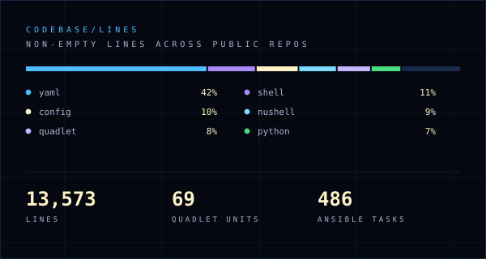<!--
--><a href="https://lichess.org/@/Spoljarevic">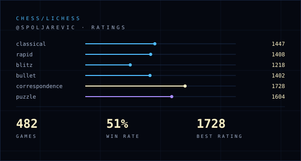</a><!--
--><!--
--><a href="https://codeberg.org/Spoljarevic/Zammad-Podman-Quadlets"></a><!--
--><!--
--><a href="https://codeberg.org/Spoljarevic/ansible-galaxy-archlinux-repomanager"></a><!--
--><!--
--><!--
--><!--
--><a href="https://codeberg.org/Spoljarevic/Dotfiles/src/branch/master/nvim"></a><!--
--><!--
--><!--
--><!--
--><!--
--><a href="https://codeberg.org/spoljarevic">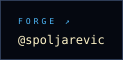</a><!--
--><a href="https://techhub.social/@spoljarevic">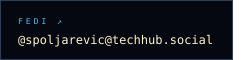</a><!--
--><a href="mailto:foss@spoljarevic.sh">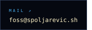</a><!--
--><a href="https://lichess.org/@/Spoljarevic">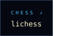</a><!--
--><!--
--><!--
--><a href="https://kb.spoljarevic.sh">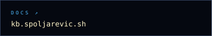</a><!--
-->

